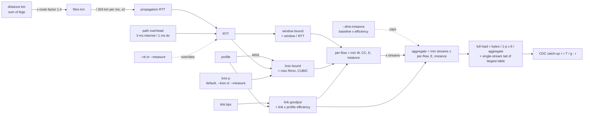

# nettransfer

**How long will a bulk TCP transfer really take over a WAN?**

`nettransfer` estimates the wall-clock time for a large data move -- an AWS DMS full load,
a database dump, an S3 sync -- from the things you actually know up front: **data size,
distance (or a measured RTT), link size, packet profile and packet loss**. It models what
TCP does under latency and loss instead of dividing bytes by bandwidth, tells you *which
ceiling is binding*, and says what to do about it. With three optional DMS inputs it also
checks whether the migration plan converges at all.

```
$ nettransfer --size 2T --from london --to dublin --link 1G --compare

Path                internet -- healthy long-haul Internet path; 0.5-2 % when congested
Packet loss         0.1000%
Approx. RTT         9.4 ms (estimated)
Goodput (modelled)  382.0 Mbps -- bottleneck: TCP loss recovery (8 stream(s), CUBIC/Reno under loss)
Full-load time      11h 38m  (line-rate ideal: 4h 26m, x2.6 slower)
==============================================================================
Path                dx -- dedicated circuit onto the AWS backbone; AWS publishes no loss SLA
Packet loss         0.0010%
Approx. RTT         7.4 ms (estimated)
Goodput (modelled)  941.5 Mbps -- bottleneck: link (line rate x profile efficiency)
Full-load time      4h 43m  (line-rate ideal: 4h 26m, x1.1 slower)
```

Same 2 TB, same 1 Gbps link: **11.6 h over the Internet, 4.7 h over Direct Connect.**
Bytes ÷ bandwidth says 4.4 h for both. That gap is why this tool exists.

Pure Python, no runtime dependencies, fully offline (one opt-in flag uses the network to
look up a city). Python ≥ 3.12.

---

## Contents

- [Install](#install)
- [Quick start](#quick-start)
- [Reading the output](#reading-the-output)
- [Features](#features)
  - [Cities, regions and routes](#cities-regions-and-routes)
  - [Real measurements with `--measure`](#real-measurements-with---measure)
  - [DMS realism](#dms-realism)
  - [Sensitivity sweeps](#sensitivity-sweeps)
  - [Output formats](#output-formats)
- [CLI reference](#cli-reference)
- [The model](#the-model)
- [Measuring the real path](#measuring-the-real-path)
- [What this does not model](#what-this-does-not-model)
- [JSON schema](#json-schema)
- [Development](#development)
- [Licence](#licence)

---

## Install

```sh
# as a tool on your PATH (recommended)
uv tool install git+https://github.com/netdevautomate/network_transfer

# or from a clone
git clone https://github.com/netdevautomate/network_transfer
cd network_transfer
uv tool install .

# or run without installing
uv run nettransfer --help
```

Upgrade with `uv tool upgrade network-transfer`; remove with `uv tool uninstall
network-transfer`. Requires [uv](https://docs.astral.sh/uv/) and Python 3.12 or newer
(uv will fetch an interpreter if needed). `pipx install git+https://...` also works.

---

## Quick start

```sh
# The question most people start with
nettransfer --size 2T --from london --to dublin --link 1G

# Internet vs Direct Connect on the same link
nettransfer --size 2T --from london --to dublin --link 1G --compare

# AWS region codes work as destinations; jumbo frames on a DX private VIF
nettransfer --size 50T --from manchester --to eu-west-1 --link 10G --path dx --profile jumbo

# No city pair? Give the distance
nettransfer --size 500G --distance 450km --link 500M --loss 0.5 --streams 1

# You measured the path -- use the real numbers
nettransfer --size 2T --from london --to dublin --link 1G --rtt 12 --loss 0.05
mtr -rwc 100 10.0.0.5 > mtr.txt && nettransfer --size 2T --from leeds --to eu-west-2 --link 1G --measure mtr.txt

# Route through the Direct Connect location, not the great circle
nettransfer --size 5T --from manchester --via london --to eu-west-1 --link 10G --path dx

# DMS migration plan: biggest table, change rate during the load, replication instance
nettransfer --size 2T --largest-table 1.2T --change-rate 40G/day --dms-instance dms.r5.large \
            --from london --to eu-west-1 --link 10G --path dx

# How sensitive is the answer to loss?
nettransfer --size 2T --from london --to sydney --link 1G --sweep loss=0.01,0.1,0.5,1

# Paste into a doc
nettransfer --size 2T --from london --to dublin --link 1G --compare --format md

# Discover what the tool knows
nettransfer --list-cities
nettransfer --list-profiles
nettransfer --list-instances
```

---

## Reading the output

Every report has the same shape: the inputs as resolved, the modelled goodput **and which
ceiling produced it**, the time, and advice keyed to that ceiling.

```
Source              London
Destination         Sydney
Approx. distance    16,990 km great circle (~23,786 km fibre @ x1.4)
Path                internet -- healthy long-haul Internet path; 0.5-2 % when congested
Link size           10.0 Gbps
Profile             full -- 1500-byte MTU, every frame full (...) (efficiency 94.1%, MSS 1448 B)
Packet loss         0.0000% (--loss)
Approx. RTT         236.3 ms (estimated)
Data size           20.00 TB
Parallel streams    1
Goodput (modelled)  213.0 Mbps -- bottleneck: TCP receive window (1 stream(s) x window/RTT)
Full-load time      1w 1d  (line-rate ideal: 4h 26m, x46.9 slower)

! Transfer exceeds ~1 week: price AWS Snowball (or ship an initial load offline and use DMS CDC to catch up).
! Bound by window/RTT, not the link: raise net.ipv4.tcp_rmem/tcp_wmem max on both ends and/or add streams ...
```

A 10 Gbps link to Sydney carrying 213 Mbps on one stream is not a broken link; it is
`6 MiB / 236 ms`. Follow the advice (`--streams 32 --tcp-window 64MiB`) and the same run
reports `9.4 Gbps -- bottleneck: link` and `4h 43m`.

| Line | Meaning |
|---|---|
| `Approx. distance` | great-circle km (summed over legs with `--via`), and the fibre km after the route factor |
| `Packet loss` / `Approx. RTT` | the values the model used, with provenance: `(estimated)`, `(--loss)`, `(--rtt)`, `(measured, mtr, 100 pkts)` |
| `Goodput (modelled)` | aggregate TCP payload rate, and the **bottleneck** that set it |
| `Full-load time` | bytes incl. retransmits ÷ goodput; the `line-rate ideal` is what bytes ÷ link would have told you |
| `Largest-table tail` | *(DMS)* how much of the load runs on one stream after the other tables finish |
| `CDC backlog` / `CDC catch-up` / `Total to cut-over` | *(DMS)* changes accrued during the load, time to replay them, and the sum |
| `!` lines | something to act on; `~` lines are context and caveats |

Bottlenecks and their fixes:

| Bottleneck | What it means | What to do |
|---|---|---|
| **link** | the pipe is full | buy bandwidth, or ship offline |
| **TCP receive window** | `window / RTT` per flow; the link is idle | raise `tcp_rmem`/`tcp_wmem`, add streams |
| **TCP loss recovery** | congestion control backs off under loss | fix the loss (DX, better peering) before buying bandwidth; jumbo frames help |
| **DMS replication instance** | the EC2 network baseline is below the link | bigger class (8xlarge+ have no burst tier), or split across instances |

---

## Features

### Cities, regions and routes

`--from` / `--to` accept ~85 built-in cities (every city hosting a public AWS region plus
common enterprise hubs), **AWS region codes** (`eu-west-1`, `us-east-1`, ...) and common
aliases (`nyc`, `bahrain`, `northern virginia`). Matching is case-insensitive and typos get
a *did you mean* suggestion. `--distance 450km` / `280mi` replaces the pair entirely.

**Cities not in the list -- `--add-city NAME`.** Looks the name up on
[OpenStreetMap Nominatim](https://nominatim.org/), prints exactly what it matched (so a
wrong hit -- Portland, Oregon vs Portland, Dorset -- is visible), and saves it to
`~/.config/nettransfer/cities.json` for every future run. Qualify with a comma to
disambiguate: `--add-city "Portland, Dorset"`. The saved key is the part before the comma
and **overrides a built-in** of the same name (flagged `[overrides built-in]`). This is the
**only flag that touches the network**; estimates are always offline. `--cities-file PATH`
relocates the store.

**Real routes -- `--via CITY`.** Traffic to `eu-west-1` from Manchester does not take the
great circle to Dublin; it rides the customer's WAN to the Direct Connect location (London)
and then the AWS backbone. `--via` (repeatable, in order) sums the legs:
Manchester → London → Dublin is 725 km, not 262 km, and the RTT follows. The route factor
still applies per leg. Cannot be combined with `--distance`.

### Real measurements with `--measure`

The distance model is a ~20 % estimate; a real measurement on the real path beats it.
`--measure FILE` (or `-` for stdin) reads pasted `ping` or `mtr` output and takes **RTT
and loss** from it, labelling both as measured in the report. Explicit `--rtt`/`--loss`
still win.

```sh
mtr -rwc 100 10.0.0.5 > mtr.txt
nettransfer --size 2T --from leeds --to eu-west-2 --link 1G --measure mtr.txt
ping -c 200 10.0.0.5 | nettransfer --size 2T --distance 300km --link 1G --measure -
```

- **ping** -- macOS/BSD (`round-trip min/avg/max/stddev`) and Linux (`rtt min/avg/max/mdev`)
  summaries. RTT is the `avg`; loss comes from the transmitted/received **counts**, not the
  rounded percentage (2/150 is 1.33 %, not the printed 1.3 %).
- **mtr** -- report mode (`-r`, `-rw`, `-rwc N`, `-rz`). The **last responding hop**
  supplies RTT (`Avg`) and loss. Loss on intermediate hops is deliberately ignored: routers
  rate-limit ICMP TTL-exceeded replies, so mid-path "loss" is normally an artefact, while
  loss at the final hop is end-to-end. If the destination filters ICMP (`???` as the last
  hop) the previous hop is used and the report says so.
- **Sample size** -- loss resolution is `1 / probes`. `0 %` over 10 packets only proves
  loss is below 10 %; the model will use 0 but the report tells you to re-measure with at
  least 100.

### DMS realism

Three optional inputs turn the network calculator into a migration-plan check:

```
$ nettransfer --size 8T --largest-table 5T --change-rate 300G/day --dms-instance dms.r5.xlarge \
              --from frankfurt --via london --to eu-west-1 --link 10G --path dx --profile jumbo

Via                 London
Approx. distance    1,101 km great circle over 2 legs (~1,542 km fibre @ x1.4)
Approx. RTT         16.1 ms (estimated)
DMS instance        1.2 Gbps baseline (1.2 Gbps goodput after framing)
Goodput (modelled)  1.2 Gbps -- bottleneck: DMS replication instance network baseline
Largest-table tail  4.57 TB on 1 stream @ 1.2 Gbps = 8h 12m (after 6h 9m parallel)
Full-load time      14h 21m  (line-rate ideal: 1h 46m, x8.1 slower)
CDC backlog         179.57 GB accrued during full load @ 3.47 MB/s (27.8 Mbps)
CDC catch-up        19m 47s (headroom 98%)
Total to cut-over   14h 41m

! Bound by the replication instance's network baseline, not the link: pick a larger class ...
! 57% of the load is a single-stream tail on the largest table: use DMS parallel-load ...
```

- **`--dms-instance CLASS`** -- a replication instance is an EC2 instance, and sizes of
  `4xlarge` and below have a *baseline* network allowance far below their advertised "up
  to" burst (`dms.r5.large`: 0.75 Gbps baseline, 10 Gbps burst). Burst credits last 5-60
  minutes; a load that runs for hours settles at the baseline. The baseline becomes a
  fourth ceiling. Figures are from the
  [EC2 Instance Types Guide](https://docs.aws.amazon.com/ec2/latest/instancetypes/mo.html)
  network tables for the classes
  [DMS supports](https://docs.aws.amazon.com/dms/latest/userguide/CHAP_ReplicationInstance.Types.html)
  (T3, C5, C6i, R5, R6i); `--list-instances` prints them. A load under an hour gets a note
  that burst may make the estimate pessimistic.
- **`--largest-table SIZE`** -- DMS parallelism is per table (`MaxFullLoadSubTasks`, default
  8). While the smaller tables share `n − 1` streams the big one gets one; when they finish,
  its remainder `L − (D − L)/(n − 1)` loads alone. No tail if `L ≤ D / n`. The tail only
  *costs* time when one stream is slower than the aggregate -- window- or loss-bound paths,
  which is exactly where DMS loads get surprised. Fix: DMS parallel-load (partitions or
  range segmentation) on that table, or its own task.
- **`--change-rate SIZE/PERIOD`** (`40G/day`, `2GB/h`, `1T/week`) -- while the full load
  runs for `T` seconds the source writes `r·T` bytes of change. Replaying it at goodput `g`
  takes `r·T/g`, during which `r·(r·T/g)` more arrives, and so on: a geometric series
  summing to **`r·T / (g − r)`**. If `r ≥ g` it **never converges** and the output says
  `NEVER` -- the most common way a cut-over plan fails. Headroom `(g − r) / g` below 50 %
  gets a warning. The `Total to cut-over` line is full load + catch-up.

### Sensitivity sweeps

The honest answer to "what's the loss on that path?" is usually "we don't know yet".
`--sweep PARAM=V1,V2,...` re-runs the estimate for each value and tabulates goodput,
bottleneck, full-load time and total-to-cut-over. Parameters: `loss`, `link`, `streams`,
`rtt`, `tcp-window`, `size`. Combine with `--compare` for a path column, `--format md` for
a Markdown table, or `--json` for a list of full results.

```
$ nettransfer --size 2T --from london --to sydney --link 1G --sweep loss=0.01,0.1,0.5,1

London -> Sydney, 2T over 1G, sweeping loss

loss  Goodput     Bottleneck         Full load  Total to cut-over
----  ----------  -----------------  ---------  -----------------
0.01  140.1 Mbps  TCP loss recovery  1d 7h      --
0.1   24.9 Mbps   TCP loss recovery  1w 10h     --
0.5   7.5 Mbps    TCP loss recovery  3w 3d      --
1     4.8 Mbps    TCP loss recovery  5w 4d      --
```

### Output formats

| `--format` | What you get |
|---|---|
| `text` (default) | aligned two-column report + advice; `--compare` separates paths with a rule |
| `md` | two-column Markdown table + bullet advice; `--compare` separates paths with `---`; sweeps become Markdown tables with a `###` heading |
| `json` (or `--json`) | every input, ceiling and derived figure; `--compare` keys by path, `--sweep` returns a list -- see [JSON schema](#json-schema) |

`--verbose` adds every ceiling computed (link goodput, per-flow window/Reno/CUBIC bounds,
propagation and overhead) to text and Markdown reports.

---

## CLI reference

Exit status is `0` on success and `2` for any usage error (bad unit, unknown city,
unparseable measurement, missing file); the message names the offending input.

**Required**

| Flag | Meaning | Default |
|---|---|---|
| `--size`, `-s` | data to move: `500G`, `2T`, `1.5P` (decimal, 10^n) or `100GiB`, `2TiB` (binary, 2^n) | required |
| `--link`, `-l` | link size in bit/s: `100M`, `1G`, `10G`; a bare number is Gbps | required |

**Where** (city pair, or explicit distance)

| Flag | Meaning | Default |
|---|---|---|
| `--from` / `--to` | city names, aliases or AWS region codes; fuzzy-matched | -- |
| `--via` | intermediate city (repeatable, in order), e.g. the DX location; legs are summed | -- |
| `--distance`, `-d` | explicit great-circle distance instead of cities: `450km`, `280mi` | -- |

**Network**

| Flag | Meaning | Default |
|---|---|---|
| `--path` | `internet` or `dx` (Direct Connect); sets loss and overhead defaults | `internet` |
| `--profile`, `-p` | `full` (1500 B), `jumbo` (9001 B, DX private/transit VIF), `imix` (shared/chatty link) | `full` |
| `--loss` | packet loss in % (`0.1` = 0.1 %) | 0.1 % internet, 0.001 % dx |
| `--rtt` | measured RTT in ms; overrides the distance estimate | estimated |
| `--measure` | read RTT and loss from pasted `ping` / `mtr -r` output (`-` = stdin) | -- |
| `--streams` | parallel TCP connections | 8 (DMS `MaxFullLoadSubTasks`) |
| `--tcp-window` | per-connection receive window | `6MiB` (Linux `tcp_rmem` max) |
| `--route-factor` | fibre path / great-circle ratio | 1.4 |

**DMS realism** (all optional)

| Flag | Meaning | Default |
|---|---|---|
| `--dms-instance` | replication instance class (`dms.r5.large`, `r6i.xlarge`); its network baseline is a ceiling | -- |
| `--largest-table` | size of the biggest single table; models the single-stream tail | -- |
| `--change-rate` | source change rate during the load, `SIZE/PERIOD` (`40G/day`, `2GB/h`); adds CDC catch-up | -- |

**Output**

| Flag | Meaning | Default |
|---|---|---|
| `--compare` | run internet and dx side by side | off |
| `--sweep` | `PARAM=V1,V2,...` over `loss`, `link`, `streams`, `rtt`, `tcp-window`, `size` | -- |
| `--format` | `text`, `md` or `json` | `text` |
| `--json` | same as `--format json` | off |
| `--verbose`, `-v` | show every ceiling computed | off |

**Discovery and maintenance** (each prints and exits)

| Flag | Meaning |
|---|---|
| `--list-cities` | every known city; user-added ones are marked `(added)` |
| `--list-profiles` | packet profiles with efficiency and MSS |
| `--list-instances` | DMS instance classes with baseline and burst bandwidth |
| `--add-city NAME` | geocode `NAME` online and save it (repeatable). **The only flag that uses the network.** |
| `--cities-file PATH` | where added cities live (default `~/.config/nettransfer/cities.json`) |
| `--version`, `--help` | |

Units: data sizes accept `b k m g t p` (decimal) and `kib mib gib tib pib` (binary), case
-insensitive, with or without a trailing `b`. Link rates accept `k m g t` with optional
`bps`. Percentages accept an optional `%`. Periods accept `s min h day week` and plurals.

---

## The model



Three network ceilings are computed per flow and the lowest wins; a fourth, the
replication-instance baseline, applies with `--dms-instance`. Per-flow bounds multiply by
the stream count and are capped again by the link and instance.

### Formulas and sources

- **Propagation.** Signal speed in single-mode fibre is c / 1.468 ≈ 204 km/ms. Fibre
  does not follow great circles; 1.3-1.5x is the usual engineering range, 1.4 is the
  default (`--route-factor`). A fixed per-path overhead (3 ms Internet, 1 ms DX) stands in
  for queueing and forwarding.
- **Profile efficiency.** TCP payload / bytes on the wire, counting Ethernet preamble +
  SFD + IFG (20 B), header + FCS (18 B), IPv4 (20 B) and TCP with timestamps/SACK (32 B).
  `full` = 1448 / 1538 = 94.1 %, `jumbo` = 8949 / 9039 = 99.0 %, `imix` = 76.9 %.
- **Window bound.** One receive window per RTT. Linux's default `tcp_rmem[2]` is 6 MiB;
  16-64 MiB is typical after tuning.
- **Loss bound.** Standard TCP (Mathis, Semke, Mahdavi, Ott, *The Macroscopic Behavior of
  the TCP Congestion Avoidance Algorithm*, 1997): `1.22 · MSS / (RTT · √p)`. CUBIC
  ([RFC 8312](https://www.rfc-editor.org/rfc/rfc8312) Eq. 7):
  `1.054 · MSS · RTT^-0.25 · p^-0.75`. CUBIC itself takes the larger of the two (its
  "TCP-friendly region"), so the model does too. The CUBIC constant is checked against
  RFC 8312 Table 2 in the tests.
- **Streams.** Per-flow bounds multiply by the number of connections, capped at link (and
  instance) goodput. DMS runs `MaxFullLoadSubTasks` (default 8) table loads in parallel,
  each on its own connection.
- **Retransmits.** Bytes on the wire grow by `1 / (1 − p)`; this applies to the full load,
  the tail and the CDC stream alike.
- **Replication instance.** EC2 baseline bandwidth, times profile efficiency (the baseline
  is measured at the ENI, so it pays the same framing).
- **Largest-table tail.** Two phases: all `n` streams until the other `D − L` bytes are
  done, then `L − (D − L)/(n − 1)` bytes on one stream at the per-flow rate.
- **CDC catch-up.** `r·T / (g − r)` for `r < g`; infinite otherwise. Headroom `(g − r)/g`.

### Defaults you should argue with

- **Packet loss.** AWS publishes no loss figure for either path -- the Hybrid Connectivity
  whitepaper describes the Internet as "best effort" and Direct Connect as
  "deterministic". 0.1 % is a healthy long-haul Internet path (congested or badly peered
  paths run 0.5-2 %); 0.001 % on DX keeps the loss model live without pretending to a
  precision nobody has. **Measure it** and pass `--loss` or `--measure`.
- **RTT.** The estimate is within ~20 % for most pairs. If you can `ping` the far end,
  pass `--rtt` or `--measure`; the distance is still printed for context.
- **Profiles.** `full` is what a bulk load looks like on the wire. `imix` is a router
  benchmark mix (7 × 64 B, 4 × 570 B, 1 × 1518 B) -- use it only when the circuit also
  carries production/transactional traffic, as the pessimistic case. On a DX private or
  transit VIF, `jumbo` is real and worth enabling.
- **Streams.** 8 is the DMS default. A single `pg_dump | psql`, `scp` or `aws s3 cp` of
  one large object is `--streams 1`; `aws s3 sync` and `s5cmd` run many.

---

## Measuring the real path

The model is for the planning meeting. Before you commit to a date, measure:

| Want | Command | Then |
|---|---|---|
| RTT and loss | `mtr -rwc 200 <target>` (or `ping -c 200 <target>`) | `--measure mtr.txt`, or read `Avg` / final-hop loss into `--rtt` / `--loss` |
| Achievable TCP throughput | `iperf3 -c <target> -P 8 -t 60` (and `-P 1` for a single flow) | compare with `Goodput (modelled)`; if iperf beats the model, raise `--tcp-window`; if it is far below, the path has a problem the model is not seeing |
| Window ceiling | `sysctl net.ipv4.tcp_rmem net.ipv4.tcp_wmem` on both ends | `--tcp-window <max>` |
| MTU on a DX VIF | `ping -M do -s 8972 <target>` (Linux) / `ping -D -s 8972` (macOS) | `--profile jumbo` only if it passes end to end |
| Source change rate | DB-specific: WAL bytes/day, redo log volume, `CDCIncomingChanges` from a trial task | `--change-rate` |

Treat loss over fewer than ~100 probes as unknown, not zero. Measure at the time of day the
load will run; peering congestion is diurnal.

---

## What this does not model

- **Source or target speed.** DMS full loads are frequently bound by the source database's
  read rate, LOB handling, or the target's write/index rate -- not the network. The output
  says so every time. Run a pilot table and compare.
- **Compression.** The WAN leg is source → replication instance and DMS sends it
  uncompressed; target-side formats (parquet, gzip) do not change the bytes on this hop.
- **Uneven table packing.** The largest-table tail assumes the *other* tables pack evenly
  across their streams; a few very large secondary tables make it optimistic.
- **Congestion from other traffic**, bufferbloat, or ECMP path asymmetry.
- **BBR.** The loss bound assumes loss-based congestion control (CUBIC/Reno). If both ends
  run BBR the loss bound is pessimistic; the window bound still applies.
- **Encryption overhead** (IPsec/VPN MTU reduction). For a VPN path, `--profile full` is
  slightly optimistic on efficiency and MSS.
- **Burst credits.** The instance ceiling uses the baseline. A load that finishes inside
  the burst window (minutes) will beat it, and the report says so.
- **Offline alternatives.** Past ~1 week the output tells you to price Snowball; it does
  not price it for you.
- **Cost.** Data into AWS is free of transfer charges; DX port and cross-connect pricing is
  a procurement question, not a transfer-time one.

---

## JSON schema

`--json` returns one object (or one per path under `"internet"` / `"dx"` with `--compare`,
or a list with `--sweep`, each item carrying `"sweep": {"<param>": "<value>"}`). All rates
are bit/s, sizes bytes, times seconds, loss a fraction. Top-level keys:

| Key | Content |
|---|---|
| `source`, `destination`, `via` | resolved labels; `via` is a list |
| `inputs` | everything the model used: `data_bytes`, `distance_km`, `link_bps`, `profile {name, efficiency, mss_bytes}`, `loss_fraction`, `loss_source`, `path`, `streams`, `tcp_window_bytes`, `route_factor`, `rtt_ms_override`, `rtt_source`, `instance_bps`, `largest_table_bytes`, `change_bps_bytes` |
| `latency` | `great_circle_km`, `fibre_km`, `propagation_one_way_ms`, `fixed_overhead_ms`, `rtt_ms`, `source` |
| `throughput` | `line_rate_bps`, `link_goodput_bps`, `per_flow_window_bound_bps`, `per_flow_reno_bound_bps`, `per_flow_cubic_bound_bps`, `per_flow_bps`, `streams`, `aggregate_bps`, `bottleneck`, `instance_bound_bps` |
| `tail` | `null`, or `parallel_bytes`, `parallel_seconds`, `tail_bytes`, `tail_seconds`, `tail_bps` |
| `cdc` | `null`, or `change_rate_bytes_per_s`, `backlog_bytes`, `catch_up_seconds` (`Infinity` when it never converges), `converges`, `headroom_fraction` |
| `measurement` | present with `--measure`: `tool`, `rtt_ms`, `loss_fraction`, `packets`, `target`, `notes` |
| `bytes_including_retransmits`, `line_rate_seconds`, `seconds`, `total_seconds` | the arithmetic |
| `transfer_time_human`, `total_time_human`, `tcp_penalty_factor`, `consider_offline_transfer` | conveniences for scripts and dashboards |

```sh
nettransfer ... --json | jq '{bottleneck: .throughput.bottleneck, hours: (.total_seconds/3600)}'
```

---

## Development

```sh
git clone https://github.com/netdevautomate/network_transfer && cd network_transfer
uv sync                                         # creates .venv with dev tools
uv run pytest                                   # 179 tests, 100 % coverage, gate at 90 %
uv run ruff check . && uv run ruff format --check .
uv run pyright                                  # strict mode
pre-commit install && pre-commit run --hook-stage manual --all-files
```

Layout (`src/network_transfer/`):

| Module | Responsibility |
|---|---|
| `units.py` | parsing (`2T`, `10G`, `0.1%`, `450km`, `40G/day`) and formatting; pure functions |
| `cities.py` | offline gazetteer, aliases and region codes, haversine, the `--add-city` store |
| `geocode.py` | Nominatim lookup for `--add-city`, with an injectable fetcher so tests stay offline |
| `dms.py` | replication-instance network allowances (EC2 Instance Types Guide figures) |
| `measure.py` | `ping` / `mtr` output parser |
| `model.py` | the physics and TCP model, the largest-table tail and CDC catch-up; every constant named and overridable |
| `cli.py` | argparse, route resolution, sweeps, text / Markdown / JSON rendering, advice |

Design rules the code follows: estimates never touch the network; every constant is a
named module-level value with a comment saying where it came from; every ceiling is
reported, not just the winner; tests are offline and fast (< 1 s), and the key model
decisions are mutation-tested (a deliberately broken formula must fail a test).

Contributions welcome. Open an issue first for new profiles, cities you think should be
built in, or model changes -- model changes need a source (RFC, paper, vendor doc) in the
PR description.

---

## Licence

MIT -- see [LICENSE](LICENSE).
