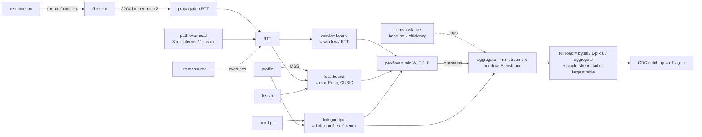

# network-transfer (`nettransfer`)

Estimate how long a bulk TCP transfer -- an AWS DMS full load, a database dump, an S3
sync -- will take over a WAN, from **data size, distance, link size, packet profile and
packet loss**. Prints the approximate RTT, the modelled goodput, *which ceiling is
binding*, and what to do about it.

```
$ nettransfer --size 2T --from london --to dublin --link 1G --compare

Source              London
Destination         Dublin
Approx. distance    463 km great circle (~649 km fibre @ x1.4)
Path                internet -- healthy long-haul Internet path; 0.5-2 % when congested
Link size           1.0 Gbps
Profile             full -- 1500-byte MTU, every frame full (...) (efficiency 94.1%, MSS 1448 B)
Packet loss         0.1000%
Approx. RTT         9.4 ms (estimated)
Data size           2.00 TB (2.00 TB incl. retransmits)
Parallel streams    8
Goodput (modelled)  382.0 Mbps -- bottleneck: TCP loss recovery (8 stream(s), CUBIC/Reno under loss)
Full-load time      11h 38m  (line-rate ideal: 4h 26m, x2.6 slower)

! Bound by loss recovery: fix the loss before buying bandwidth -- ...
==============================================================================
Path                dx -- dedicated circuit onto the AWS backbone; AWS publishes no loss SLA
Packet loss         0.0010%
Approx. RTT         7.4 ms (estimated)
Goodput (modelled)  941.5 Mbps -- bottleneck: link (line rate x profile efficiency)
Full-load time      4h 43m  (line-rate ideal: 4h 26m, x1.1 slower)
```

That gap -- 11.6 h vs 4.7 h on the *same* 1 Gbps link -- is the whole reason the tool
exists. Dividing bytes by link speed ignores what TCP does under latency and loss.

## Install

```sh
uv tool install .            # from this directory; gives you `nettransfer` on PATH
# or run without installing
uv run nettransfer --help
```

Python >= 3.12, no runtime dependencies.

## Usage

```
nettransfer --size 2T --from london --to dublin --link 1G
nettransfer --size 50T --from manchester --to eu-west-1 --link 10G --path dx --profile jumbo
nettransfer --size 500G --distance 450km --link 500M --loss 0.5 --streams 1
nettransfer --size 2T --from london --to sydney --link 1G --compare --verbose
nettransfer --size 2T --from london --to dublin --link 1G --rtt 12 --loss 0.05 --json
nettransfer --add-city "Leeds" --add-city "Portland, Dorset"   # fetch from OpenStreetMap, save
nettransfer --size 1T --from leeds --to eu-west-2 --link 1G
nettransfer --list-cities
nettransfer --list-profiles
nettransfer --list-instances

# DMS realism: biggest table, change rate during the load, replication instance class
nettransfer --size 2T --largest-table 1.2T --change-rate 40G/day --dms-instance dms.r5.large \
            --from london --to eu-west-1 --link 10G --path dx

# Sensitivity: one table across plausible values instead of five runs
nettransfer --size 2T --from london --to sydney --link 1G --sweep loss=0.01,0.1,0.5,1

# Markdown for Quip/Confluence/a customer doc
nettransfer --size 2T --from london --to dublin --link 1G --compare --format md
```

### DMS realism

Three optional inputs turn the network calculator into a migration-plan check:

```
$ nettransfer --size 2T --largest-table 1.2T --change-rate 40G/day --dms-instance dms.r5.large \
              --from london --to eu-west-1 --link 10G --path dx

DMS instance        750.0 Mbps baseline (706.1 Mbps goodput after framing)
Goodput (modelled)  706.1 Mbps -- bottleneck: DMS replication instance network baseline
Largest-table tail  1.09 TB on 1 stream @ 607.3 Mbps = 3h 58m (after 2h 52m parallel)
Full-load time      6h 51m  (line-rate ideal: 26m 40s, x15.4 slower)
CDC backlog         11.42 GB accrued during full load @ 462.97 kB/s (3.7 Mbps)
CDC catch-up        2m 10s (headroom 99%)
Total to cut-over   6h 53m

! Bound by the replication instance's network baseline, not the link: pick a larger class ...
! 58% of the load is a single-stream tail on the largest table: use DMS parallel-load ...
```

- **`--dms-instance CLASS`** -- a replication instance is an EC2 instance, and sizes of
  `4xlarge` and below have a *baseline* network allowance far below their "up to" burst
  (`dms.r5.large`: 0.75 Gbps baseline, 10 Gbps burst). Burst credits last 5-60 minutes; a
  load that runs for hours settles at the baseline, so a 10 G Direct Connect into an
  `r5.large` delivers 0.75 G. The baseline becomes a fourth ceiling. Figures are from the
  [EC2 Instance Types Guide](https://docs.aws.amazon.com/ec2/latest/instancetypes/mo.html)
  network tables for the classes DMS supports (T3, C5, C6i, R5, R6i); `--list-instances`.
- **`--largest-table SIZE`** -- DMS parallelism is per table (`MaxFullLoadSubTasks` tables
  at once). While the smaller tables share `n - 1` streams the big one gets one stream;
  when they finish, its remainder (`L - (D - L)/(n - 1)`) loads alone. There is no tail if
  the largest table is within its fair share (`L <= D / n`). The tail only *costs* time
  when one stream is slower than the aggregate -- i.e. on window- or loss-bound paths,
  which is exactly where DMS loads get surprised. Fix: DMS parallel-load (partitions or
  range segmentation) on that table.
- **`--change-rate SIZE/PERIOD`** -- while the full load runs for `T` seconds the source
  writes `r * T` bytes of change. Replaying it at goodput `g` takes `r T / g`, during which
  `r (r T / g)` more arrives, and so on: a geometric series summing to `r T / (g - r)`.
  If `r >= g` it **never converges** and the output says so -- the most common way a
  cut-over plan fails. Headroom `(g - r) / g` under 50 % gets a warning.

### Sensitivity sweeps

`--sweep PARAM=V1,V2,...` re-runs the estimate for each value and tabulates goodput,
bottleneck, full-load time and total-to-cut-over. Parameters: `loss`, `link`, `streams`,
`rtt`, `tcp-window`, `size`. Combine with `--compare` for a path column, `--format md` for
a Markdown table, or `--json` for a list of full results.

```
London -> Sydney, 2T over 1G, sweeping loss

loss  Goodput     Bottleneck         Full load  Total to cut-over
----  ----------  -----------------  ---------  -----------------
0.01  140.1 Mbps  TCP loss recovery  1d 7h      --
0.1   24.9 Mbps   TCP loss recovery  1w 10h     --
0.5   7.5 Mbps    TCP loss recovery  3w 3d      --
1     4.8 Mbps    TCP loss recovery  5w 4d      --
```

### Output formats

`--format text` (default), `--format md` (two-column Markdown table + bullet advice; compare
mode separates paths with `---`), `--format json` (same as `--json`).

### Cities not in the built-in list

`--add-city NAME` looks the name up on [OpenStreetMap Nominatim](https://nominatim.org/),
prints what it matched so you can see a wrong hit (Portland, Oregon vs Portland, Dorset),
and saves it to `~/.config/nettransfer/cities.json` for every future run. Add a qualifier
after a comma to disambiguate (`"Portland, Dorset"`); the saved key is the part before the
comma, and a saved city overrides a built-in of the same name (flagged as
`[overrides built-in]`). This is the **only** flag that touches the network — estimates
themselves are fully offline. `--cities-file PATH` relocates the store.

| Flag | Meaning | Default |
|---|---|---|
| `--size` | data to move: `500G`, `2T`, `1.5P` (decimal) or `100GiB`, `2TiB` (binary) | required |
| `--link` | link size in bit/s: `100M`, `1G`, `10G` | required |
| `--from` / `--to` | city names or AWS region codes (`eu-west-1`, `us-east-1`); fuzzy-matched | -- |
| `--distance` | explicit great-circle distance instead of cities: `450km`, `280mi` | -- |
| `--add-city` | geocode NAME online and save it for future runs (repeatable); exits | -- |
| `--cities-file` | where added cities live | `~/.config/nettransfer/cities.json` |
| `--path` | `internet` or `dx` (Direct Connect); sets loss and overhead defaults | `internet` |
| `--profile` | `full` (1500 B), `jumbo` (9001 B, DX only), `imix` (shared/chatty link) | `full` |
| `--loss` | packet loss in % (`0.1` = 0.1 %) | 0.1 % internet, 0.001 % dx |
| `--rtt` | measured RTT in ms; overrides the distance estimate | estimated |
| `--streams` | parallel TCP connections | 8 (DMS `MaxFullLoadSubTasks`) |
| `--tcp-window` | per-connection receive window | `6MiB` (Linux `tcp_rmem` max) |
| `--route-factor` | fibre path / great-circle ratio | 1.4 |
| `--dms-instance` | DMS replication instance class; its network baseline is a ceiling | -- |
| `--largest-table` | size of the biggest table; models the single-stream tail | -- |
| `--change-rate` | source change rate during the load (`40G/day`); adds CDC catch-up | -- |
| `--sweep` | `PARAM=V1,V2,...` over `loss`, `link`, `streams`, `rtt`, `tcp-window`, `size` | -- |
| `--compare` | run internet and dx side by side | off |
| `--format` | `text`, `md` or `json` | `text` |
| `--json` | same as `--format json` | off |
| `--verbose` | show every ceiling computed | off |

## The model



Three network ceilings are computed and the lowest one wins (a fourth, the replication
instance baseline, applies when `--dms-instance` is given). The output names which one
bound, because the fix is different in each case:

| Bottleneck | What it means | What to do |
|---|---|---|
| **link** | the pipe is full | buy bandwidth, or ship offline |
| **TCP receive window** | `window / RTT` per flow; the link is idle | raise `tcp_rmem`/`tcp_wmem`, add streams |
| **TCP loss recovery** | congestion control backs off under loss | fix the loss (DX, better peering) before buying bandwidth; jumbo frames help |
| **DMS replication instance** | the EC2 baseline allowance is below the link | bigger class (8xlarge+ have no burst tier), or split across instances |

### Formulas and sources

- **Propagation**: signal speed in single-mode fibre is c / 1.468 ≈ 204 km/ms. Fibre
  does not follow great circles; 1.3-1.5x is the usual range, 1.4 is the default.
- **Profile efficiency**: TCP payload / bytes on the wire, with Ethernet preamble + SFD +
  IFG (20 B), header + FCS (18 B), IPv4 (20 B) and TCP with timestamps/SACK (32 B).
  `full` = 1448 / 1538 = 94.1 %, `jumbo` = 8949 / 9039 = 99.0 %, `imix` = 76.9 %.
- **Window bound**: one receive window per RTT. Linux's default `tcp_rmem[2]` is 6 MiB.
- **Loss bound**: Standard TCP (Mathis, Semke, Mahdavi, Ott 1997)
  `1.22 * MSS / (RTT * sqrt(p))`, and CUBIC (RFC 8312 Eq. 7)
  `1.054 * MSS * RTT^-0.25 * p^-0.75`. CUBIC itself takes the larger of the two (its
  "TCP-friendly region"), so the model does too. The CUBIC constant is checked against
  RFC 8312 Table 2 in the tests.
- **Streams**: per-flow bounds multiply by the number of connections, capped at link
  goodput. DMS runs `MaxFullLoadSubTasks` (default 8) table loads in parallel, each on its
  own connection.
- **Retransmits**: bytes on the wire grow by `1 / (1 - p)`.

### Defaults you should argue with

- **Packet loss.** AWS publishes no loss figure for either path -- the Hybrid Connectivity
  whitepaper describes the Internet as "best effort" and Direct Connect as
  "deterministic". 0.1 % is a healthy long-haul Internet path (congested or badly peered
  paths run 0.5-2 %); 0.001 % on DX keeps the loss model live without pretending to a
  precision nobody has. **Measure it**: `mtr -rwc 200 <target>` on the actual path, then
  pass `--loss`.
- **RTT.** The estimate is within ~20 % for most pairs. If you can `ping` the far end,
  pass `--rtt` and the model uses your number (the distance is still printed for context).
- **Profiles.** `full` is what a bulk load looks like on the wire. `imix` is a router
  benchmark mix (7 x 64 B, 4 x 570 B, 1 x 1518 B); use it only when the circuit also
  carries production/transactional traffic, as the pessimistic case. On a DX private or
  transit VIF, `jumbo` is real and worth enabling.

## What this does *not* model

- **Source or target speed.** DMS full loads are frequently bound by the source database's
  read rate, LOB handling, or the target's write/index rate -- not the network. The output
  says so every time. Run a pilot table and compare.
- **Compression.** The WAN leg is source -> replication instance and DMS sends it
  uncompressed; target-side formats (parquet, gzip) do not change the bytes on this hop.
- **Uneven table packing.** The largest-table tail assumes the *other* tables pack evenly
  across their streams; a few very large secondary tables make it optimistic.
- **Congestion from other traffic**, bufferbloat, or ECMP path asymmetry.
- **BBR.** The loss bound assumes loss-based congestion control (CUBIC/Reno). If both ends
  run BBR, the loss bound is pessimistic; the window bound still applies.
- **Encryption overhead** (IPsec/VPN MTU reduction). If the path is a VPN, use
  `--profile full` and knock the MSS down mentally, or add a profile.
- **Offline alternatives.** Past ~1 week of transfer the output tells you to price
  Snowball; it does not price it for you.

## Development

```sh
uv sync
uv run pytest                                   # 157 tests, coverage gate 90 %
uv run ruff check . && uv run ruff format --check .
uv run pyright                                  # strict
pre-commit run --hook-stage manual --all-files  # same gate the repo's hooks enforce
```

Layout: `src/network_transfer/units.py` (parsing/formatting), `cities.py` (offline
gazetteer + haversine + user store), `geocode.py` (Nominatim lookup for --add-city),
`dms.py` (replication-instance network allowances), `model.py` (the physics and TCP model
plus the DMS tail and CDC refinements, every constant named), `cli.py` (argparse, sweep,
text/Markdown/JSON rendering, advice).
