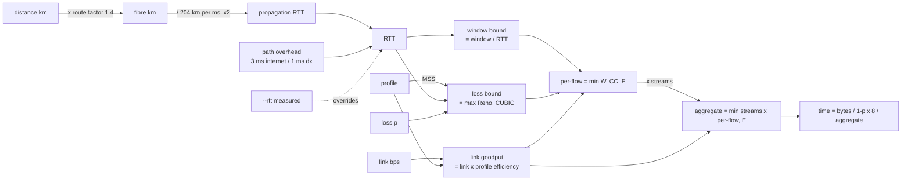

# network-transfer (`nettransfer`)

Estimate how long a bulk TCP transfer -- an AWS DMS full load, a database dump, an S3
sync -- will take over a WAN, from **data size, distance, link size, packet profile and
packet loss**. Prints the approximate RTT, the modelled goodput, *which ceiling is
binding*, and what to do about it.

```
$ nettransfer --size 2T --from london --to dublin --link 1G --compare

Source              London
Destination         Dublin
Approx. distance    463 km great circle (~649 km fibre @ x1.4)
Path                internet -- healthy long-haul Internet path; 0.5-2 % when congested
Link size           1.0 Gbps
Profile             full -- 1500-byte MTU, every frame full (...) (efficiency 94.1%, MSS 1448 B)
Packet loss         0.1000%
Approx. RTT         9.4 ms (estimated)
Data size           2.00 TB (2.00 TB incl. retransmits)
Parallel streams    8
Goodput (modelled)  382.0 Mbps -- bottleneck: TCP loss recovery (8 stream(s), CUBIC/Reno under loss)
Transfer time       11h 38m  (line-rate ideal: 4h 26m, x2.6 slower)

! Bound by loss recovery: fix the loss before buying bandwidth -- ...
==============================================================================
Path                dx -- dedicated circuit onto the AWS backbone; AWS publishes no loss SLA
Packet loss         0.0010%
Approx. RTT         7.4 ms (estimated)
Goodput (modelled)  941.5 Mbps -- bottleneck: link (line rate x profile efficiency)
Transfer time       4h 43m  (line-rate ideal: 4h 26m, x1.1 slower)
```

That gap -- 11.6 h vs 4.7 h on the *same* 1 Gbps link -- is the whole reason the tool
exists. Dividing bytes by link speed ignores what TCP does under latency and loss.

## Install

```sh
uv tool install .            # from this directory; gives you `nettransfer` on PATH
# or run without installing
uv run nettransfer --help
```

Python >= 3.12, no runtime dependencies.

## Usage

```
nettransfer --size 2T --from london --to dublin --link 1G
nettransfer --size 50T --from manchester --to eu-west-1 --link 10G --path dx --profile jumbo
nettransfer --size 500G --distance 450km --link 500M --loss 0.5 --streams 1
nettransfer --size 2T --from london --to sydney --link 1G --compare --verbose
nettransfer --size 2T --from london --to dublin --link 1G --rtt 12 --loss 0.05 --json
nettransfer --list-cities
nettransfer --list-profiles
```

| Flag | Meaning | Default |
|---|---|---|
| `--size` | data to move: `500G`, `2T`, `1.5P` (decimal) or `100GiB`, `2TiB` (binary) | required |
| `--link` | link size in bit/s: `100M`, `1G`, `10G` | required |
| `--from` / `--to` | city names or AWS region codes (`eu-west-1`, `us-east-1`); fuzzy-matched | -- |
| `--distance` | explicit great-circle distance instead of cities: `450km`, `280mi` | -- |
| `--path` | `internet` or `dx` (Direct Connect); sets loss and overhead defaults | `internet` |
| `--profile` | `full` (1500 B), `jumbo` (9001 B, DX only), `imix` (shared/chatty link) | `full` |
| `--loss` | packet loss in % (`0.1` = 0.1 %) | 0.1 % internet, 0.001 % dx |
| `--rtt` | measured RTT in ms; overrides the distance estimate | estimated |
| `--streams` | parallel TCP connections | 8 (DMS `MaxFullLoadSubTasks`) |
| `--tcp-window` | per-connection receive window | `6MiB` (Linux `tcp_rmem` max) |
| `--route-factor` | fibre path / great-circle ratio | 1.4 |
| `--compare` | run internet and dx side by side | off |
| `--json` | machine-readable output | off |
| `--verbose` | show every ceiling computed | off |

## The model



Three ceilings are computed and the lowest one wins. The output names which one bound,
because the fix is different in each case:

| Bottleneck | What it means | What to do |
|---|---|---|
| **link** | the pipe is full | buy bandwidth, or ship offline |
| **TCP receive window** | `window / RTT` per flow; the link is idle | raise `tcp_rmem`/`tcp_wmem`, add streams |
| **TCP loss recovery** | congestion control backs off under loss | fix the loss (DX, better peering) before buying bandwidth; jumbo frames help |

### Formulas and sources

- **Propagation**: signal speed in single-mode fibre is c / 1.468 ≈ 204 km/ms. Fibre
  does not follow great circles; 1.3-1.5x is the usual range, 1.4 is the default.
- **Profile efficiency**: TCP payload / bytes on the wire, with Ethernet preamble + SFD +
  IFG (20 B), header + FCS (18 B), IPv4 (20 B) and TCP with timestamps/SACK (32 B).
  `full` = 1448 / 1538 = 94.1 %, `jumbo` = 8949 / 9039 = 99.0 %, `imix` = 76.9 %.
- **Window bound**: one receive window per RTT. Linux's default `tcp_rmem[2]` is 6 MiB.
- **Loss bound**: Standard TCP (Mathis, Semke, Mahdavi, Ott 1997)
  `1.22 * MSS / (RTT * sqrt(p))`, and CUBIC (RFC 8312 Eq. 7)
  `1.054 * MSS * RTT^-0.25 * p^-0.75`. CUBIC itself takes the larger of the two (its
  "TCP-friendly region"), so the model does too. The CUBIC constant is checked against
  RFC 8312 Table 2 in the tests.
- **Streams**: per-flow bounds multiply by the number of connections, capped at link
  goodput. DMS runs `MaxFullLoadSubTasks` (default 8) table loads in parallel, each on its
  own connection.
- **Retransmits**: bytes on the wire grow by `1 / (1 - p)`.

### Defaults you should argue with

- **Packet loss.** AWS publishes no loss figure for either path -- the Hybrid Connectivity
  whitepaper describes the Internet as "best effort" and Direct Connect as
  "deterministic". 0.1 % is a healthy long-haul Internet path (congested or badly peered
  paths run 0.5-2 %); 0.001 % on DX keeps the loss model live without pretending to a
  precision nobody has. **Measure it**: `mtr -rwc 200 <target>` on the actual path, then
  pass `--loss`.
- **RTT.** The estimate is within ~20 % for most pairs. If you can `ping` the far end,
  pass `--rtt` and the model uses your number (the distance is still printed for context).
- **Profiles.** `full` is what a bulk load looks like on the wire. `imix` is a router
  benchmark mix (7 x 64 B, 4 x 570 B, 1 x 1518 B); use it only when the circuit also
  carries production/transactional traffic, as the pessimistic case. On a DX private or
  transit VIF, `jumbo` is real and worth enabling.

## What this does *not* model

- **Source or target speed.** DMS full loads are frequently bound by the source database's
  read rate, LOB handling, or the target's write/index rate -- not the network. The output
  says so every time. Run a pilot table and compare.
- **Congestion from other traffic**, bufferbloat, or ECMP path asymmetry.
- **BBR.** The loss bound assumes loss-based congestion control (CUBIC/Reno). If both ends
  run BBR, the loss bound is pessimistic; the window bound still applies.
- **Encryption overhead** (IPsec/VPN MTU reduction). If the path is a VPN, use
  `--profile full` and knock the MSS down mentally, or add a profile.
- **Offline alternatives.** Past ~1 week of transfer the output tells you to price
  Snowball; it does not price it for you.

## Development

```sh
uv sync
uv run pytest                                   # 83 tests, coverage gate 90 %
uv run ruff check . && uv run ruff format --check .
uv run pyright                                  # strict
pre-commit run --hook-stage manual --all-files  # same gate the repo's hooks enforce
```

Layout: `src/network_transfer/units.py` (parsing/formatting), `cities.py` (offline
gazetteer + haversine), `model.py` (the physics and TCP model, every constant named),
`cli.py` (argparse, text/JSON rendering, advice).
